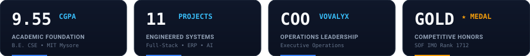

<!-- HERO BANNER -->

  

<!-- DYNAMIC TYPING ANIMATION -->

  

<!-- QUICK BADGES & TELEMETRY -->

  
  
  
  
  
  

 

<!-- METRICS STRIP -->

 

<!-- ================= 01 // PROFESSIONAL OVERVIEW ================= -->

I'm **Vishesh G Devanur**, a Computer Science & Engineering undergraduate at **Maharaja Institute of Technology, Mysore** maintaining a **9.55 CGPA**, concurrently serving as **Chief Operating Officer (COO)** at **Vovalyx**.

I architect and ship robust systems across **multi-tenant enterprise SaaS**, **institutional governance ERPs**, **scalable web utilities**, and **offline-first Edge AI architectures**. My philosophy centers around precision, speed, and building technology around the way operations actually work — not the other way around.

<table>
<tr>
<td width="50%" valign="top">

### 🎯 Primary Disciplines
* **Enterprise ERP & Governance:** Institutional admission, academic grading, examination workflows, and attendance tabulation.
* **Multi-Tenant SaaS Architecture:** Cryptographic role isolation, automated billing, dues reconciliation, and verification hashes.
* **Edge AI & Local Intelligence:** Running quantized Small Language Models (SLMs) and on-device Speech-to-Text (Whisper) with zero internet dependency.
* **Operational Leadership:** Directing engineering roadmaps, sprint execution, code review standards, and client deliverables.

</td>
<td width="50%" valign="top">

### ⚡ Quick Facts
* 🎓 **Academics:** B.E. in CSE at MIT Mysore &bull; **9.55 CGPA** (Top Tier Academic Standing)
* 💼 **Executive Role:** Chief Operating Officer (COO) at **Vovalyx**
* 🚀 **Engineered Projects:** **11 systems & applications** across institutional ERP, enterprise SaaS, utilities, and AI prototypes
* 🥇 **Competitive Honors:** SOF International Mathematics Olympiad Gold Medalist (Int'l Rank 1712)
* 🏏 **Athletics:** Champions of VTU Inter-College Tournament (Mysuru District, 2026) & U-16 Champions (2021)

</td>
</tr>
</table>

 

<!-- ================= 02 // LEADERSHIP & EXPERIENCE ================= -->

### Chief Operating Officer (COO) &mdash; **Vovalyx**
**Executive Leadership &bull; Operations & Governance &bull; PRESENT**

> *"Driving organizational leadership, operational coordination, and the connection between business objectives and technology execution."*

<table>
<tr>
<td width="25%" align="center">
<h3>COO</h3>
<strong>Executive Leadership</strong>
</td>
<td width="25%" align="center">
<h3>OPS</h3>
<strong>Strategic Governance</strong>
</td>
<td width="25%" align="center">
<h3>Agile</h3>
<strong>Execution & Growth</strong>
</td>
<td width="25%" align="center">
<h3>IN</h3>
<strong>Global Operations</strong>
</td>
</tr>
</table>

**Core Responsibilities & Executive Governance:**
* **Operational Leadership:** Directing organizational growth, cross-functional operations, and translating core business objectives into concrete execution milestones.
* **Strategic Alignment:** Connecting client requirements, institutional partnerships, and product roadmaps with scalable technology delivery.
* **Operational Efficiency:** Establishing standards for operational governance, workflow optimization, and high-impact cross-team coordination.

 

#### Software Studio Experience &mdash; [YVB&Co](https://yvb-co.vercel.app)
*Independent Technology Studio &bull; Software Engineering & Systems Delivery*
* Contributed to system architecture, full-stack implementations, and production web platforms across client and institutional engagements.

 

<!-- ================= 03 // SELECTED WORK & SYSTEMS ================= -->

Here is a curated showcase of **11 production systems, SaaS utilities, and AI architectures** designed and built from the ground up:

<table>
<tr>
<td width="50%" valign="top">

### 01. [No-Due Portal](https://noc-portal-self.vercel.app/login) `[SAAS]`
**Multi-Tenant Clearance Management System**
* Digitize institutional student No Due Certificate clearance workflows.
* Connects faculty, department coordinators, library, accounts, HODs, and admin.
* Automated due tracking, fine reconciliation, and digital certificate PDF generation with verification hashes.
* **Stack:** `Next.js` · `TypeScript` · `Tailwind CSS` · `PostgreSQL` · `Prisma`
* 🔗 **Live:** [noc-portal-self.vercel.app](https://noc-portal-self.vercel.app/login)

</td>
<td width="50%" valign="top">

### 02. [AcadOps ERP](https://erp-client-9lbk.vercel.app/login?tenant=test) `[ERP]`
**Engineering College Governance Platform**
* Governance-focused ERP managing the full academic lifecycle from admissions to graduation.
* Real-time attendance tracking with internal assessment (IA) tabulation.
* Examination scheduling, grading workflows, and result publication.
* Institutional Role-Based Access Control (RBAC) and mentorship tracking.
* **Stack:** `React` · `Node.js` · `Express` · `PostgreSQL` · `RBAC`
* 🔗 **Live:** [erp-client-9lbk.vercel.app](https://erp-client-9lbk.vercel.app/login?tenant=test)

</td>
</tr>

<tr>
<td width="50%" valign="top">

### 03. [MITM PlacePro](https://mitm-placepro.vercel.app) `[SYSTEMS]`
**Campus Placement Management Platform**
* Full-stack recruitment operations system for the central placement office.
* Automated student eligibility filtering based on company cutoff criteria.
* End-to-end recruitment drive tracking: assessment rounds, interview scheduling.
* Real-time placement analytics and direct recruiter-candidate feedback loops.
* **Stack:** `Next.js` · `React` · `Supabase` · `PostgreSQL` · `Tailwind CSS`
* 🔗 **Live:** [mitm-placepro.vercel.app](https://mitm-placepro.vercel.app)

</td>
<td width="50%" valign="top">

### 04. [MRF Platform](https://mitm-rd.vercel.app/) `[RESEARCH]`
**Maharaja Research Foundation Portal**
* Digital research administration platform managing the academic PhD scholar lifecycle.
* Candidate registration, supervisor allocation, and guide verification.
* Research Advisory Committee (RAC) half-yearly review evaluations.
* Centralized tracking for patents, SCI/Scopus publications, and viva examinations.
* **Stack:** `Next.js` · `TypeScript` · `Tailwind CSS` · `Prisma` · `PostgreSQL`
* 🔗 **Live:** [mitm-rd.vercel.app](https://mitm-rd.vercel.app/)

</td>
</tr>

<tr>
<td width="50%" valign="top">

### 05. ENILS `[AI & EDGE]`
**Edge-Native Interactive Learning System**
* Offline AI tutoring system designed for schools with zero/limited internet.
* 100% offline edge architecture running local speech recognition (Whisper).
* Quantized Small Language Models (SLMs) and text-to-speech on low-cost hardware.
* Voice-interactive curriculum tutoring, question answering, and student feedback.
* **Stack:** `Python` · `Local LLMs` · `Whisper STT` · `TTS` · `Edge AI` · `Raspberry Pi`

</td>
<td width="50%" valign="top">

### 06. Disaster Management `[AI & ROBOTICS]`
**Collaborative 3D Mapping & Emergency Ops**
* Crowdsourced emergency response system utilizing ordinary smartphone camera feeds.
* Generates navigable 3D emergency environments via photogrammetry under disaster conditions.
* Real-time tactical coordinate mapping and hazard hotspot identification.
* Designed for constrained emergency bandwidth and search-and-rescue teams.
* **Stack:** `React Native` · `Python` · `3D Rendering` · `WebRTC` · `Spatial Algorithms`

</td>
</tr>

<tr>
<td width="50%" valign="top">

### 07. [UniConv](https://uniconv-psi.vercel.app/) `[SAAS]`
**File Conversion & Manipulation Utility**
* Modern browser-native utility platform providing privacy-focused file conversion.
* Client-side WebAssembly execution for instant conversions with zero data leakage.
* Multi-format conversion across PDF, document formats, images, audio, and video.
* Drag-and-drop user experience with batch processing capabilities.
* **Stack:** `Next.js` · `WebAssembly (WASM)` · `TypeScript` · `Tailwind CSS`
* 🔗 **Live:** [uniconv-psi.vercel.app](https://uniconv-psi.vercel.app/)

</td>
<td width="50%" valign="top">

### 08. [NEET Rank Analyzer](https://github.com/visheshdevanur/Neet-rank-analyzer) `[ANALYTICS]`
**Performance & Rank Prediction Engine**
* Data modeling tool predicting competitive exam rank percentiles from mock marks.
* Historical multi-year seat allocation and cutoff trends data parsing.
* College cutoff filtering and probability matching for state and All-India quotas.
* Detailed performance metric breakdowns and eligibility distributions.
* **Stack:** `Python` · `Data Analytics` · `React` · `Tailwind CSS` · `Statistical Models`
* 🔗 **Repo:** [Neet-rank-analyzer](https://github.com/visheshdevanur/Neet-rank-analyzer)

</td>
</tr>

<tr>
<td width="50%" valign="top">

### 09. [Event Flow](https://eventflow-indol.vercel.app/) `[SAAS & AI]`
**Academic Event Lifecycle Management**
* State-machine-driven event engine: `Draft` &rarr; `Pending` &rarr; `Approved` &rarr; `Completed`.
* Separate role-authenticated portals for Principal, HOD, and Coordinators (JWT + bcrypt).
* Private registration and feedback forms behind cryptographic link hashes.
* Google Gemini API paired with `ai_evaluations` table for automated evaluation summaries.
* **Stack:** `Vite` · `TypeScript` · `Express` · `Supabase` · `Google Gemini AI`
* 🔗 **Live:** [eventflow-indol.vercel.app](https://eventflow-indol.vercel.app/)

</td>
<td width="50%" valign="top">

### 10. [CartFill](https://cart-fill.vercel.app/) `[FULL STACK]`
**Shopping List & Inventory Management**
* Intuitive, responsive web application for organizing shopping requirements.
* Persistent cloud data storage powered by Supabase with real-time updates.
* Mobile-first responsive layout built with Tailwind CSS and fast Vite development.
* Instant item categorization, completion status toggling, and search filters.
* **Stack:** `React` · `Vite` · `Supabase` · `Tailwind CSS` · `JavaScript`
* 🔗 **Live:** [cart-fill.vercel.app](https://cart-fill.vercel.app/)

</td>
</tr>

<tr>
<td colspan="2" valign="top">

### 11. [ReliefChain](https://reliefchain-pied.vercel.app/) `[SYSTEMS & SOCIAL IMPACT]`
**Transparent Aid-Flow & Disaster Relief Platform**
* Solves the transparency gap in disaster relief by establishing a traceable pipeline: `Donation` &rarr; `Verification` &rarr; `Allocation` &rarr; `Delivery` &rarr; `Impact`.
* Donor-facing verification dashboard displaying real-time tracking, allocation status, and delivery receipts.
* Structured allocation workflows and audit-ready reporting for relief organizations and NGOs.
* **Stack:** `React` · `TypeScript` · `Node.js` · `PostgreSQL` · `Tailwind CSS`
* 🔗 **Live:** [reliefchain-pied.vercel.app](https://reliefchain-pied.vercel.app/)

</td>
</tr>
</table>

 

<!-- ================= 04 // TECHNICAL ARSENAL ================= -->

  

<table>
<tr>
<td width="25%" valign="top">
<strong>Core & Languages</strong> 
• TypeScript 
• JavaScript (ES6+) 
• Python 
• C 
• C++ 
• SQL
</td>
<td width="25%" valign="top">
<strong>Frontend & UI</strong> 
• Next.js (App Router) 
• React.js 
• Tailwind CSS 
• Vite 
• HTML5 / CSS3 
• Framer Motion
</td>
<td width="25%" valign="top">
<strong>Backend & Data</strong> 
• Node.js / Express 
• NestJS 
• PostgreSQL 
• Supabase 
• Prisma ORM / TypeORM 
• REST APIs / JWT / RBAC
</td>
<td width="25%" valign="top">
<strong>AI & Systems</strong> 
• Local LLMs (Ollama, llama.cpp) 
• Whisper Speech-to-Text 
• GGUF Quantization 
• Google Gemini API 
• Edge AI (Raspberry Pi) 
• WebAssembly (WASM)
</td>
</tr>
</table>

 

<!-- ================= 05 // ACADEMIC FOUNDATION ================= -->

| Qualification | Institution | Duration | Score / Honors |
|---|---|---|---|
| **B.E. — Computer Science & Engineering** | Maharaja Institute of Technology, Mysore (MITM) | 2022 – Present | **9.55 CGPA** (Top Tier Standing) |
| **Pre-University Course (PUC) — Science** | Gopalswamy PU College, Mysuru | 2020 – 2022 | **87.3%** (Distinction) |
| **Secondary School Leaving Certificate (10th)** | Excel Public School, Mysuru | Graduated 2020 | **86.6%** (First Class with Distinction) |

 

<!-- ================= 06 // HONORS & ATHLETICS ================= -->

<table>
<tr>
<td width="50%" valign="top">

### 🏆 Academic & Hackathon Honors
* 🥇 **SOF International Mathematics Olympiad (IMO):** Gold Medal (School Level) • International Rank 1712
* 🥇 **National-Level Math-Science LiveOlympiad:** Gold Medalist
* 🏆 **1st Place — Escape X:** MITM Campus Hackathon & Logic Competition (2025)
* 🏆 **1st Place — TECHNOVA 2.0:** Web Wizards Web Development Challenge
* 📜 **Institutional Software Recognition:** Official college Appreciation Letter for developing institutional systems
* 🛰️ **ISRO BAH Hackathon 2026:** Bharatiya Antariksh Hackathon participant working on satellite-imagery road resilience

</td>
<td width="50%" valign="top">

### 🏏 Competitive Athletic Championships
* 🏆 **VTU Inter-College Tournament (Mysuru District):** Champions (MITM College Cricket Team, 2026)
* 🏅 **VTU State-Level Tournament:** 4th Place in Karnataka State (2026)
* 🏆 **Mysuru Zone Cricket Championship (U-16):** Champions (2021)
* 🎖️ **Malnad Cup U-14 Tournament:** Best Bowler Award (Pace & Line Discipline)
* 🎥 **Creative Media:** Creator of [@visheshcoditz](https://youtube.com/@visheshcoditz) on YouTube &bull; Technical visual storytelling, motion graphics & software demonstrations

</td>
</tr>
</table>

 

<!-- ================= 07 // GITHUB TELEMETRY ================= -->

<!-- GitHub Stats & Top Languages with Exact Dark Portfolio Theme -->

  

<!-- Contribution Streak -->

  

<!-- Contribution Activity Graph -->

  

<!-- Contribution Snake -->

 

<!-- ================= 08 // INITIATE CONTACT ================= -->

I'm always interested in connecting with engineers, founders, researchers, and technology leaders building meaningful products.

  
  
  
  
  

 

  

    VISHESH G DEVANUR &bull; CHIEF OPERATING OFFICER @ VOVALYX &bull; ALL RIGHTS RESERVED &bull; 2026
  

