

 

**CREATIVE DEVELOPER &nbsp;·&nbsp; CREATIVE TECHNOLOGY PROFESSIONAL &nbsp;·&nbsp; PRODUCT ENGINEER**

[Portfolio](https://visheshgdevanur.vercel.app) &nbsp;·&nbsp; [Projects](#featured-projects) &nbsp;·&nbsp; [Edge AI](#edge-ai) &nbsp;·&nbsp; [Toolkit](#technology-toolkit) &nbsp;·&nbsp; [Education](#education) &nbsp;·&nbsp; [Contact](#contact)

 

I am **Vishesh G Devanur**, a Computer Science and Engineering undergraduate at **Maharaja Institute of Technology, Mysore** (CGPA **9.55**).

I am passionate about software engineering, product development, enterprise systems, creative technology and intelligent applications. I enjoy taking ideas from concept to implementation, combining architecture, development, design and product thinking.

My primary active technical interest is **Edge AI**. I serve as **Chief Operating Officer at VOVALYX**.

 

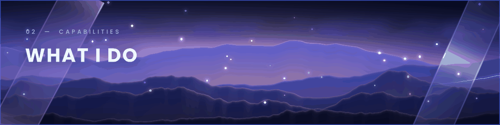

<table>
  <tr>
    <td width="50%" valign="top">
      
      <h3>Product Engineering</h3>
      Turning ideas into functional, practical and scalable software products.
    </td>
    <td width="50%" valign="top">
      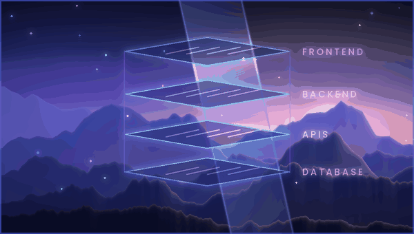
      <h3>Full-Stack Development</h3>
      Building connected applications across frontend, backend, databases and infrastructure.
    </td>
  </tr>
  <tr>
    <td width="50%" valign="top">
      
      <h3>Edge AI</h3>
      Exploring efficient local AI inference and intelligent applications running closer to users and devices.
    </td>
    <td width="50%" valign="top">
      
      <h3>Creative Technology</h3>
      Combining technology, design, motion and creative experimentation.
    </td>
  </tr>
</table>

 

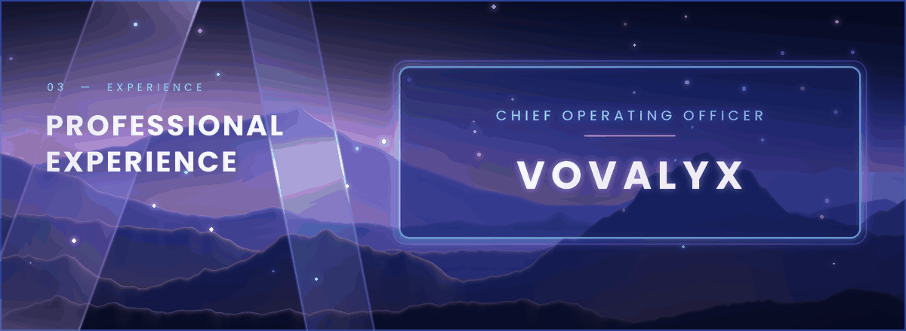

### CHIEF OPERATING OFFICER · VOVALYX

Working at the intersection of technology, product development and business operations, contributing to the development of technology-driven initiatives.

 

## FEATURED PROJECTS

<a href="https://noc-portal-self.vercel.app">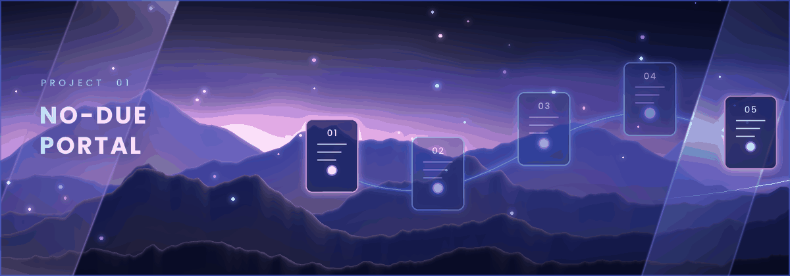</a>

**Multi-Tenant Clearance SaaS** &nbsp;·&nbsp; [Live project](https://noc-portal-self.vercel.app)

A digital clearance platform designed to streamline institutional no-due workflows through a structured multi-tenant system.

`Next.js` `TypeScript` `Tailwind CSS` `PostgreSQL` `Prisma ORM`

 

<a href="https://erp-client-9lbk.vercel.app">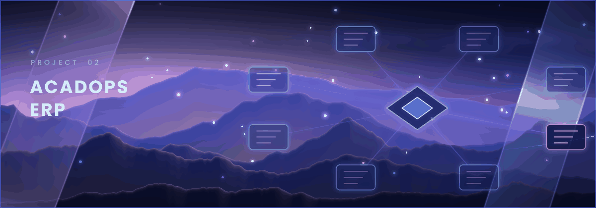</a>

**Engineering College Governance ERP** &nbsp;·&nbsp; [Live project](https://erp-client-9lbk.vercel.app)

An ERP platform focused on bringing academic and administrative operations into a connected digital system.

`React.js` `Node.js` `Express` `PostgreSQL` `RBAC` `Tailwind CSS`

 

<a href="https://mitm-placepro.vercel.app">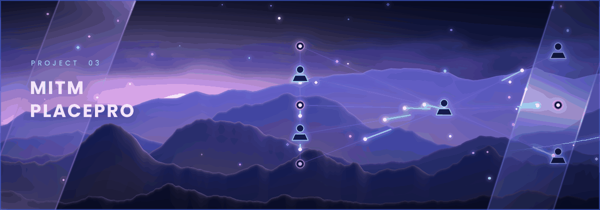</a>

**Campus Placement Management** &nbsp;·&nbsp; [Live project](https://mitm-placepro.vercel.app)

A placement-management platform designed to organize campus recruitment activities and placement-related workflows.

`Next.js` `React` `Supabase` `PostgreSQL` `Tailwind CSS`

 

<a href="https://mitm-rd.vercel.app">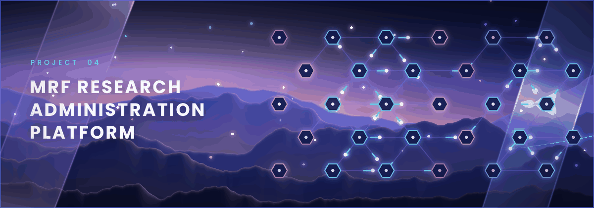</a>

**Research Management System** &nbsp;·&nbsp; [Live project](https://mitm-rd.vercel.app)

A digital platform developed around research administration and institutional research workflows for Maharaja Research Foundation.

`Next.js` `TypeScript` `Tailwind CSS` `Prisma ORM` `PostgreSQL`

 

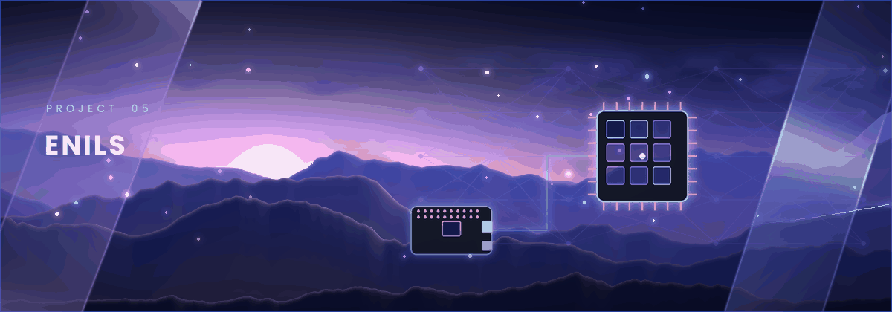

**Edge-Native Interactive Learning System** &nbsp;·&nbsp; Offline AI prototype

An exploration of offline-capable interactive learning powered by Edge AI and locally executed intelligence.

`Python` `Local LLMs` `Whisper` `TTS` `Edge AI` `React`

 

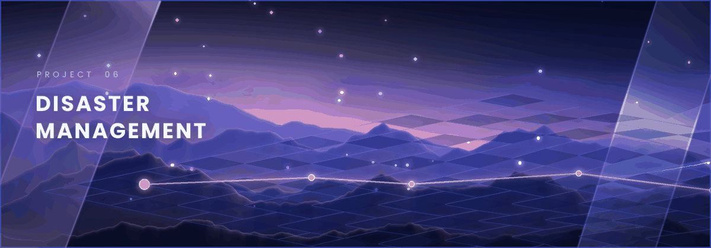

**Collaborative 3D Mapping & Emergency Operations** &nbsp;·&nbsp; Concept

A disaster-management concept focused on collaborative spatial mapping and emergency-response coordination.

`React Native` `Python` `3D Rendering` `WebRTC`

 

### ADDITIONAL PROJECTS

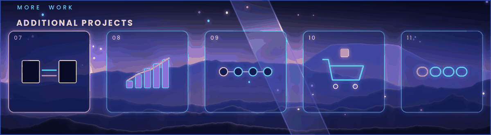

<table>
  <tr>
    <td width="20%" valign="top"><b>07 · <a href="https://uniconv-psi.vercel.app">UniConv</a></b> File Conversion & Manipulation SaaS</td>
    <td width="20%" valign="top"><b>08 · <a href="https://github.com/visheshdevanur/Neet-rank-analyzer">NEET Rank Analyzer</a></b> Data-Driven Exam Prediction Platform</td>
    <td width="20%" valign="top"><b>09 · <a href="https://eventflow-indol.vercel.app">Event Flow</a></b> Academic Event Lifecycle Management</td>
    <td width="20%" valign="top"><b>10 · <a href="https://cart-fill.vercel.app">CartFill</a></b> Real-Time Inventory & Shopping Tracker</td>
    <td width="20%" valign="top"><b>11 · <a href="https://reliefchain-pied.vercel.app">ReliefChain</a></b> Transparent Aid-Flow & Relief Pipeline</td>
  </tr>
</table>

 

## EDGE AI

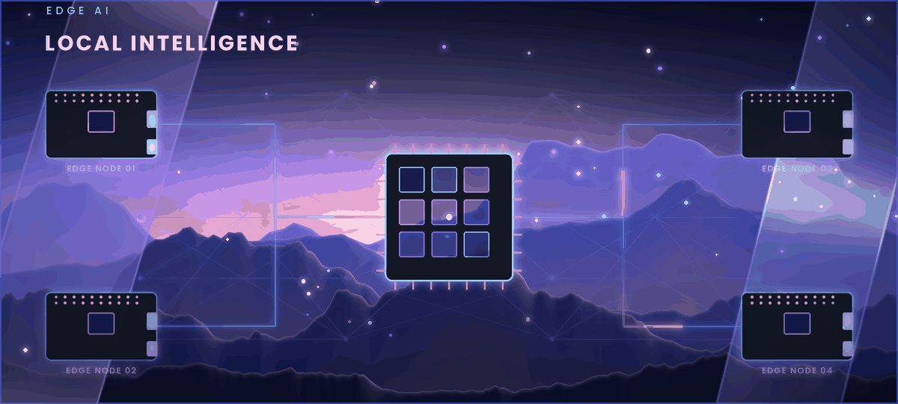

Edge AI is my primary active technical interest: building intelligent applications that run efficiently on small, local hardware, without depending on the cloud.

| | |
|---|---|
| **Local AI inference** | **Small Language Models** |
| **Offline-first intelligent applications** | **GGUF quantization** |
| **Ollama** · **llama.cpp** | **Whisper** · **Text-to-speech** |
| **Raspberry Pi** | **Edge computing** |

 

## TECHNOLOGY TOOLKIT

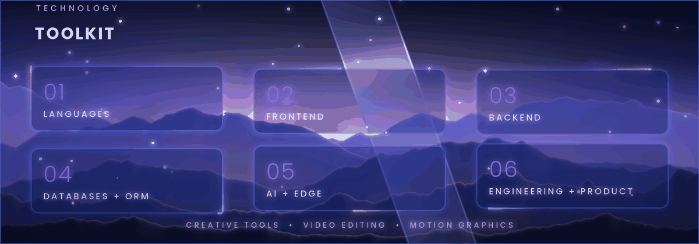

<table>
  <tr>
    <td width="33%" valign="top"><b>LANGUAGES</b> TypeScript · JavaScript · Python · C · C++</td>
    <td width="33%" valign="top"><b>FRONTEND</b> React · Next.js · Tailwind CSS · Vite</td>
    <td width="33%" valign="top"><b>BACKEND</b> Node.js · Express · NestJS · REST APIs</td>
  </tr>
  <tr>
    <td valign="top"><b>DATABASES & ORM</b> PostgreSQL · Supabase · Prisma · TypeORM</td>
    <td valign="top"><b>AI & EDGE TECHNOLOGIES</b> Ollama · llama.cpp · GGUF · Whisper · TTS · Gemini API · Local LLMs</td>
    <td valign="top"><b>ENGINEERING & PRODUCT</b> JWT · RBAC · ERP Architecture · Multi-Tenant Systems · Git · GitHub · CI/CD</td>
  </tr>
  <tr>
    <td colspan="3" valign="top"><b>CREATIVE TOOLS</b> &nbsp;·&nbsp; Video Editing · Motion Graphics</td>
  </tr>
</table>

 

## EDUCATION

| | Institution | Result |
|---|---|---|
| **B.E. — Computer Science and Engineering** | Maharaja Institute of Technology, Mysore | **CGPA 9.55** |
| **Pre-University Course** | Gopalswamy PU College | **87.3%** |
| **SSLC** | Excel Public School | **86.6%** |

 

## ACHIEVEMENTS

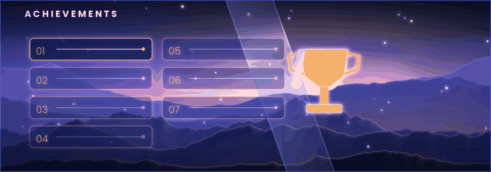

- **1st Place** — MITM Escape X Hackathon, 2025
- **Gold** — SOF International Mathematics Olympiad, International Rank 1712
- **Gold** — National-Level LiveOlympiad Mathematics and Science
- **Champions** — VTU Cricket District Tournament, 2026
- **4th Place** — VTU State Cricket Tournament, 2026
- **Champions** — Mysuru Zone U-16 Cricket, 2021
- **Best Bowler Award** — Malnad Cup U-14

 

## GITHUB

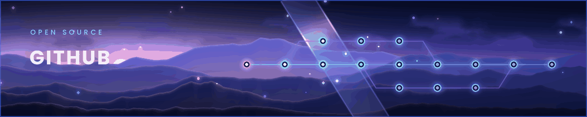

  
  

 

## CONTACT

**BUILD WITH PURPOSE. &nbsp;ENGINEER WITH CURIOSITY. &nbsp;CREATE WHAT MATTERS.**

[Portfolio](https://visheshgdevanur.vercel.app) &nbsp;·&nbsp; [GitHub](https://github.com/visheshdevanur) &nbsp;·&nbsp; [LinkedIn](https://www.linkedin.com/in/vishesh-g-devanur) &nbsp;·&nbsp; [Email](mailto:visheshdevanur@gmail.com) &nbsp;·&nbsp; [YouTube](https://www.youtube.com/@visheshcoditz)

`Code` · `Create` · `Inspire`

